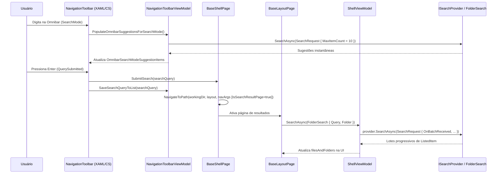

# F060 M5-T0 — Mapa da Busca (Somente Leitura)

- **Tarefa:** M5-T0 do `tasks.md` (F060 — Diferenciais: M5 Busca por frase em linguagem natural)
- **Data/Hora:** 2026-10-27 06:55 (horário local)
- **Worktree:** `C:\desenv\utils\KyraFiles-f060-m5`
- **Branch:** `feature/f060-m5-natural-search`
- **Responsável:** AGY (executora)
- **Revisor:** Claude (arquiteto)
- **Status:** CONCLUÍDO (somente leitura do código, sem alteração em `src/` ou `tests/`, sem build, sem tela)

---

## 1. Onde a busca recebe a consulta e os filtros de extensão, data de modificação e tamanho

### 1.1 `FolderSearch.cs` (`src/KyraFiles.App/Utils/Storage/Search/FolderSearch.cs`)

- **Recebimento da consulta (Query e Folder):**
  - **CONFIRMED** (`git grep -n "public string? Query" src/KyraFiles.App/Utils/Storage/Search/FolderSearch.cs`):
    - Linha 30: `public string? Query { get; set; }`
    - Linha 32: `public string? Folder { get; set; }`
    - Linha 34: `public uint MaxItemCount { get; set; } = 0;` (0 = sem limite).
  - A busca não recebe filtros estruturados separados em `FolderSearch`; tudo entra como texto livre na string `Query`.

- **Detecção de formato e AQS:**
  - **CONFIRMED** (`git grep -n "IsAQSQuery" src/KyraFiles.App/Utils/Storage/Search/FolderSearch.cs`):
    - Linha 40: `private bool IsAQSQuery => Query is not null && (Query.StartsWith('$') || Query.Contains(':', StringComparison.Ordinal));`
    - Linhas 42–55: `QueryWithWildcard`: se a consulta contém '.', converte ex.: `".docx"` para `"*.docx*"`; senão retorna `"{Query}*"`.
    - Linhas 57–76: `AQSQuery`: se começa com `$` extrai `Query.Substring(1)`; se contém `:` preserva a query inteira; senão envolve em `System.FileName:\"{escaped}\"` ou `System.FileName:{QueryWithWildcard}`.

- **Filtro de tags:**
  - **CONFIRMED** (`git grep -n "IsTagQuery" src/KyraFiles.App/Utils/Storage/Search/FolderSearch.cs`):
    - Linhas 196–199: `IsTagQuery(AQSQuery)` detecta `tag:` (insensível a maiúsculas).
    - Linhas 210–259: `ParseTagQuery(string query)` faz o parsing de `tag:`, `NOT tag:`, `AND`, `OR` em `TagQueryExpression`.
    - Linhas 298–388: `SearchTagsAsync` consulta o banco SQLite local (`FileTagsHelper.GetDbInstance().GetAllUnderPath(folder)`).

- **Filtros de extensão, data de modificação e tamanho no `FolderSearch`:**
  - **CONFIRMED** (leitura de `src/KyraFiles.App/Utils/Storage/Search/FolderSearch.cs` linhas 78–186 e 855–872):
    - **Caminho WinRT (Windows Search via indexador do sistema):**
      - Linhas 152–154 e 855–872: o método `ToQueryOptions()` cria `QueryOptions` passando `UserSearchFilter = AQSQuery ?? string.Empty` para `folder.CreateItemQueryWithOptions(options)`.
      - O motor do Windows Search entende AQS nativo (ex.: `ext:ini`, `datemodified:last week`, `size:>100MB`, `System.DateModified`, `System.Size`). No entanto, o `FolderSearch.cs` **não** valida, nem decompõe, nem manipula esses filtros; apenas os repassa como texto se a consulta contiver `:` ou começar com `$`.
    - **Caminho Win32 puro (`SearchWithWin32Async`):**
      - Linhas 416–626: busca recursiva direta via `FindFirstFileEx($"{folder}\\*{QueryWithWildcard}", ...)` e `FindNextFile`.
      - Só avalia o nome do arquivo (`*{QueryWithWildcard}`).
      - Linhas 504–506 e 634–636: lê data de modificação (`ftLastWriteTime`), data de criação (`ftCreationTime`) e tamanho (`Win32FindDataExtensions.GetSize(findData)`), e linhas 507/643–646 lê a extensão (`Path.GetExtension(itemPath)`), mas **não aplica nenhum filtro** sobre eles. Todos os arquivos que coincidem com a máscara de nome são adicionados aos resultados.

---

### 1.2 Biblioteca de Índice (`src/KyraFiles.App.Search.Index`)

- **Protocolo IPC (`IndexPipeProtocol.cs`):**
  - **CONFIRMED** (`git grep -n "class IndexPipeRequest" src/KyraFiles.App.Search.Index/Ipc/IndexPipeProtocol.cs`):
    - Linhas 24–34 em `src/KyraFiles.App.Search.Index/Ipc/IndexPipeProtocol.cs`:
      ```csharp
      public sealed class IndexPipeRequest
      {
          public int Version { get; set; } = IndexPipeProtocol.CurrentVersion;
          public string Command { get; set; } = string.Empty; // "query", "ping", etc.
          public string? RequestId { get; set; }
          public string? Query { get; set; }
          public string? ScopePath { get; set; }
          public int MaxResults { get; set; } = 100_000;
          public Guid? VolumeGuid { get; set; }
          public string[]? ExcludedPaths { get; set; }
      }
      ```
    - O payload de requisição IPC recebe apenas `Query` (string de texto livre) e `ScopePath` (escopo da pasta). Não existem campos para extensão, data ou tamanho.

- **Compilação e casamento de termos (`QueryMatcher.cs`):**
  - **CONFIRMED** (`git grep -n "class QueryMatcher" src/KyraFiles.App.Search.Index/Query/QueryMatcher.cs`):
    - Linhas 23–50 em `src/KyraFiles.App.Search.Index/Query/QueryMatcher.cs`: o construtor decompõe a query por espaços (`query.Split(' ', ...)`), normaliza cada token com `NameNormalizer.Normalize` (FormD → tira marcas → minúsculas → FormC) e armazena padrões com curingas (`*` e `?`) em array de `TermPattern`.
    - Linhas 70–91: `MatchesNormalized` e `MatchesNormalizedUtf8` testam se o nome do arquivo contém todos os termos (AND implícito) ou satisfaz os curingas.
    - Não avalia filtros de extensão, data de modificação ou tamanho.

- **Execução da busca (`QueryEngine.cs`):**
  - **CONFIRMED** (`git grep -n "public QueryExecutionResult Execute" src/KyraFiles.App.Search.Index/Engine/QueryEngine.cs`):
    - Linhas 36–43 e 64–115 em `src/KyraFiles.App.Search.Index/Engine/QueryEngine.cs`:
      - `Execute(VolumeIndex volume, QueryMatcher matcher, Action<IReadOnlyList<SearchResultItem>> batchCallback, int scopeParentIndex = -1, int maxResults = DefaultMaxResults, CancellationToken cancellationToken = default)`
      - O laço varre os índices de 0 a `volume.Count - 1`.
      - Aplica: (1) checagem de exclusão lógica (`volume.IsDeleted(i)`); (2) escopo da pasta (`scopeFolders`); (3) correspondência de nome em UTF-8 (`matcher.MatchesNormalizedUtf8(normalizedUtf8)`).
      - Não há filtragem por extensão, data ou tamanho durante a varredura do índice.

- **Disponibilidade dos metadados no índice (`VolumeIndex.cs` e `SearchResultItem.cs`):**
  - **CONFIRMED** (`git grep -n "SearchResultItem GetItem" src/KyraFiles.App.Search.Index/Storage/VolumeIndex.cs`):
    - Linhas 586–598 e 617–623 em `src/KyraFiles.App.Search.Index/Storage/VolumeIndex.cs`:
      O `VolumeIndex` já mantém em memória arrays contíguos de metadados indexados pelo ID do item:
      - `_fileSizes` (`long[]`)
      - `_lastWriteTimesUtcTicks` (`long[]`) — data de modificação
      - `_creationTimesUtcTicks` (`long[]`) — data de criação
      - `_fileAttributes` (`uint[]`)
    - `SearchResultItem` (`src/KyraFiles.App.Search.Index/Models/SearchResultItem.cs:9–18`) e `SearchResultDto` (`src/KyraFiles.App.Search.Index/Ipc/IndexPipeProtocol.cs:72–82`) já expõem `FileSize`, `CreationTime`, `LastWriteTime`, `FileAttributes` e `IsDirectory`.
  - **INFERRED:** Para o motor de índice suportar filtros de extensão, data e tamanho de forma nativa e sem alocação, basta que o `QueryMatcher` ou um novo `IndexQueryFilter` avalie `_fileSizes[i]`, `_lastWriteTimesUtcTicks[i]` e a extensão antes de instanciar `GetItem(i)`.

---

### 1.3 Contratos de Busca no App (`ISearchProvider` e `SearchRequest`)

- **CONFIRMED** (`git grep -n "class SearchRequest" src/KyraFiles.App/Data/Contracts/ISearchProvider.cs`):
  - Linhas 21–43 em `src/KyraFiles.App/Data/Contracts/ISearchProvider.cs`:
    ```csharp
    public sealed class SearchRequest
    {
        public string Query { get; init; } = string.Empty;
        public string Folder { get; init; } = string.Empty;
        public uint MaxItemCount { get; init; }
        public bool SearchSubfolders { get; init; } = true;
        public bool SearchContent { get; init; }
        public Action<IReadOnlyList<ListedItem>>? OnBatchReceived { get; init; }
        public Action<string>? OnFallbackNotice { get; init; }
        public Action<int>? OnTruncated { get; init; }
    }
    ```
  - `SearchRequest` não contém propriedades separadas para filtros de extensão, intervalo de datas ou faixa de tamanhos.
- **Provedores existentes:**
  - `NativeFilesSearchProvider.cs`: recebe `SearchRequest`, enumera via `FileSystemEnumerable` e só filtra pelo nome via `FileSystemName.MatchesSimpleExpression` ou `fileName.Contains` (linhas 152–165).
  - `IndexedSearchProvider.cs`: recebe `SearchRequest`, repassa `request.Query` via Named Pipe ao `KyraFiles.App.IndexService.exe` (linhas 108–112). Se a consulta contiver `$`, `tag:` ou `System.` (linhas 258–267), delega diretamente para o provedor fallback `_fallbackProvider` (linhas 74–79).

---

## 2. Se já existe filtro estruturado no código

- **CONFIRMED:** **NÃO existe filtro estruturado para extensão, data de modificação e tamanho** em nenhuma camada do KyraFiles atual.
  - Não há classes, registros ou enums representando filtros por faixa de tamanho (ex.: `< 10 MB`, `> 100 MB`), intervalos de data de modificação (ex.: últimos 7 dias, intervalo customizado) ou lista de extensões (ex.: `.ini`, `.png`).
- **Único filtro estruturado existente no app:**
  - **CONFIRMED** (`git ls-files src/KyraFiles.App/Utils/Storage/Search`):
    - `TagQueryExpression.cs` e `TagTerm.cs` (`src/KyraFiles.App/Utils/Storage/Search/TagQueryExpression.cs`, `TagTerm.cs`).
    - Atende exclusivamente à sintaxe de tags: `tag:"nome"`, `NOT tag:"nome"`, com combinações `AND` e `OR`.
- **Sintaxe AQS (Advanced Query Syntax do Windows):**
  - **CONFIRMED:** Suportada de forma opaca apenas quando a busca é repassada para o indexador nativo do Windows em `FolderSearch.ToQueryOptions()` (`QueryOptions.UserSearchFilter`).
  - O KyraFiles não possui analisador léxico/sintático (parser) de AQS, nem converte AQS em objetos, nem suporta edição de termos AQS como chips visuais na interface.
- **Necessidade para M5 (Busca por frase):**
  - **INFERRED:** Para atender ao M5-AC-1 a AC-5, a tarefa M5-T1 deve introduzir em `src/KyraFiles.Shared/Helpers/NaturalSearchParser.cs` uma estrutura limpa (ex.: `SearchIntent` ou `NaturalSearchFilter`) contendo:
    - `SearchText`: texto remanescente para busca por nome/conteúdo;
    - `FileExtensions`: lista de extensões identificadas (ex.: `[".ini"]`);
    - `DateModifiedRange`: intervalo de datas (`DateTimeOffset? From`, `DateTimeOffset? To`);
    - `DateCreatedRange`: intervalo de datas de criação (`DateTimeOffset? From`, `DateTimeOffset? To`);
    - `SizeRange`: intervalo de tamanho em bytes (`long? MinBytes`, `long? MaxBytes`);
    - `UnrecognizedTokens`: termos que o parser não compreendeu, para cumprir M5-AC-3 ("coisas bonitas" → não entendeu).

---

## 3. Como a barra/omnibar chama a busca

O fluxo de chamada da busca a partir da Omnibar foi mapeado em 5 etapas sequenciais confirmadas no código:



### Detalhamento das etapas com comandos e linhas:

1. **Digitação interativa e sugestões instantâneas na Omnibar:**
   - **CONFIRMED** (`git grep -n "Omnibar_TextChanged" src/KyraFiles.App/UserControls/NavigationToolbar.xaml.cs`):
     - Linhas 274–285 em `NavigationToolbar.xaml.cs`: o evento `Omnibar_TextChanged` dispara quando o usuário digita no modo de busca.
     - Linhas 1260–1340 em `src/KyraFiles.App/ViewModels/UserControls/NavigationToolbarViewModel.cs`: `PopulateOmnibarSuggestionsForSearchMode()` aplica um debounce de 200 ms (`await Task.Delay(200, token)`).
     - Linhas 1293–1304: obtém o provedor atual via `ISearchProviderFactory.GetCurrentProvider()`. Se disponível, dispara `provider.SearchAsync(new SearchRequest { Query = OmnibarSearchModeText, Folder = shellViewModel.WorkingDirectory, MaxItemCount = 10 }, results, token)`.
     - Linhas 1306–1314: se não houver provedor registrado, instancia `FolderSearch` diretamente com `MaxItemCount = 10`.
     - Linhas 1326–1340: preenche `OmnibarSearchModeSuggestionItems` para o dropdown da Omnibar.

2. **Submissão da busca (Enter ou seleção de sugestão):**
   - **CONFIRMED** (`git grep -n "Omnibar_QuerySubmitted" src/KyraFiles.App/UserControls/NavigationToolbar.xaml.cs`):
     - Linhas 173 e 228–272 em `NavigationToolbar.xaml.cs`: o evento `Omnibar_QuerySubmitted` recebe `OmnibarQuerySubmittedEventArgs`.
     - Linhas 260–262: resolve o texto da query (`searchQuery = args.Item is SuggestionModel x && !string.IsNullOrWhiteSpace(x.Name) ? x.Name : args.Text`).
     - Linha 264: invoca `shellPage?.SubmitSearch(searchQuery);`.
     - Linha 265: salva no histórico via `viewModel.SaveSearchQueryToList(searchQuery);`.

3. **Roteamento e navegação no Shell (`BaseShellPage.cs`):**
   - **CONFIRMED** (`git grep -n "public void SubmitSearch" src/KyraFiles.App/Views/Shells/BaseShellPage.cs`):
     - Linhas 542–563 em `src/KyraFiles.App/Views/Shells/BaseShellPage.cs`:
       ```csharp
       public void SubmitSearch(string query)
       {
           var shellViewModel = this.GetRequiredShellViewModel();
           shellViewModel.CancelSearch();
           InstanceViewModel.CurrentSearchQuery = query;

           var args = new NavigationArguments()
           {
               AssociatedTabInstance = this,
               IsSearchResultPage = true,
               SearchPathParam = shellViewModel.WorkingDirectory,
               SearchQuery = query,
           };

           var layout = InstanceViewModel.FolderSettings.GetLayoutType(shellViewModel.WorkingDirectory);
           if (layout == typeof(ColumnsLayoutPage))
               NavigateToPath(shellViewModel.WorkingDirectory, typeof(DetailsLayoutPage), args);
           else
               NavigateToPath(shellViewModel.WorkingDirectory, layout, args);
       }
       ```

4. **Ativação da página de layout (`BaseLayoutPage.cs`):**
   - **CONFIRMED** (`git grep -n "IsSearchResultPage" src/KyraFiles.App/Views/Layouts/BaseLayoutPage.cs`):
     - Linhas 604 e 644–680 em `src/KyraFiles.App/Views/Layouts/BaseLayoutPage.cs`:
       - Linha 604: marca `parentShellPage.InstanceViewModel.IsPageTypeSearchResults = args.IsSearchResultPage;`.
       - Linha 671: atualiza o cabeçalho/endereço: `parentShellPage.UpdatePathUIToWorkingDirectoryAsync(null, string.Format(Strings.SearchPagePathBoxOverrideText.GetLocalizedResource(), args.SearchQuery, displayName))`.
       - Linhas 672–679: instancia `FolderSearch` com a query e pasta de trabalho e despacha:
         ```csharp
         var searchInstance = new Utils.Storage.FolderSearch
         {
             Query = args.SearchQuery,
             Folder = searchPath,
         };
         _ = shellViewModel.SearchAsync(searchInstance);
         ```

5. **Execução assíncrona com streaming no ViewModel (`ShellViewModel.cs`):**
   - **CONFIRMED** (`git grep -n "public async Task SearchAsync(FolderSearch search)" src/KyraFiles.App/ViewModels/ShellViewModel.cs`):
     - Linhas 3495–3616 em `src/KyraFiles.App/ViewModels/ShellViewModel.cs`:
       - Linhas 3500–3505: cancela busca ativa anterior, inicializa `searchCTS = new CancellationTokenSource()`, limpa `filesAndFolders`, ativa bandeiras `IsLoadingItems = true`, `IsSearchResults = true`, `HasNoWatcher = true`.
       - Linhas 3534–3586: obtém `ISearchProviderFactory.GetCurrentProvider()`. Se configurado (`NativeFilesSearchProvider`, `IndexedSearchProvider`, `EverythingSearchProvider` ou `AgentRansackSearchProvider`), monta `SearchRequest` com callbacks assíncronos:
         - `OnBatchReceived`: publica lotes parciais diretamente na coleção visual sem recálculo completo de ordenação (jank-free);
         - `OnFallbackNotice`: exibe aviso caso haja fallback para busca tradicional;
         - `OnTruncated`: avisa limite atingido.
       - Linha 3586: executa `await provider.SearchAsync(request, results, searchCTS.Token);`.
       - Linhas 3588–3591: caso não haja provedor, executa o método legado `await search.SearchAsync(results, searchCTS.Token);`.

---

## 4. Onde ficaria uma flag experimental em GeneralSettingsService

Conforme exigido pela especificação (`spec.md` §3 M5 e `tasks.md` M5-T2), a busca por frase é um recurso experimental e deve nascer desligado por padrão.

A estrutura padrão de configurações do KyraFiles para opções em `GeneralSettingsService` é a seguinte:

### 4.1 Interface `IGeneralSettingsService`
- **Arquivo:** `src/KyraFiles.App/Data/Contracts/IGeneralSettingsService.cs`
- **CONFIRMED** (`git grep -n "interface IGeneralSettingsService" src/KyraFiles.App/Data/Contracts/IGeneralSettingsService.cs`):
  - Linha 6 define `public interface IGeneralSettingsService : IBaseSettingsService, INotifyPropertyChanged`.
  - Local indicado para a propriedade: seção de busca ou flags gerais (próximo à linha 66, onde fica `PreviousSearchQueriesList`, ou no fim da interface antes da linha 367):
    ```csharp
    /// <summary>
    /// Gets or sets a value indicating whether natural language search (FR-M5) is enabled.
    /// </summary>
    bool EnableNaturalLanguageSearch { get; set; }
    ```

### 4.2 Implementação `GeneralSettingsService`
- **Arquivo:** `src/KyraFiles.App/Services/Settings/GeneralSettingsService.cs`
- **CONFIRMED** (`git grep -n "class GeneralSettingsService" src/KyraFiles.App/Services/Settings/GeneralSettingsService.cs`):
  - Linha 6: herda `BaseObservableJsonSettings` e implementa `IGeneralSettingsService`.
  - O mecanismo `Get(defaultValue)` / `Set(value)` persiste automaticamente em JSON (`LocalSettings.json`):
    ```csharp
    public bool EnableNaturalLanguageSearch
    {
        get => Get(false); // Desligada por padrão (FR-M5, experimental)
        set => Set(value);
    }
    ```

### 4.3 ViewModel `GeneralViewModel`
- **Arquivo:** `src/KyraFiles.App/ViewModels/Settings/GeneralViewModel.cs`
- **CONFIRMED** (`git grep -n "class GeneralViewModel" src/KyraFiles.App/ViewModels/Settings/GeneralViewModel.cs`):
  - Linha 21: `GeneralViewModel : ObservableObject`.
  - Expõe a propriedade para o binding XAML com notificação de alteração (exemplo análogo a `EnableSmoothScrolling` na linha 595):
    ```csharp
    public bool EnableNaturalLanguageSearch
    {
        get => UserSettingsService.GeneralSettingsService.EnableNaturalLanguageSearch;
        set
        {
            if (value != UserSettingsService.GeneralSettingsService.EnableNaturalLanguageSearch)
            {
                UserSettingsService.GeneralSettingsService.EnableNaturalLanguageSearch = value;
                OnPropertyChanged();
            }
        }
    }
    ```

### 4.4 Página de Configurações XAML (`GeneralPage.xaml`)
- **Arquivo:** `src/KyraFiles.App/Views/Settings/GeneralPage.xaml`
- **CONFIRMED** (`git grep -n "SettingsCard" src/KyraFiles.App/Views/Settings/GeneralPage.xaml`):
  - Linhas 348–354 (bloco `Scrolling` / `EnableSmoothScrolling`) exemplificam a inclusão de um cartão de opção com `ToggleSwitch`:
    ```xaml
    <!--  Natural Language Search (Experimental)  -->
    <wctcontrols:SettingsCard Header="{helpers:ResourceString Name=EnableNaturalLanguageSearch}"
                              Description="{helpers:ResourceString Name=EnableNaturalLanguageSearchDescription}">
        <wctcontrols:SettingsCard.HeaderIcon>
            <FontIcon Glyph="&#xE721;" />
        </wctcontrols:SettingsCard.HeaderIcon>
        <ToggleSwitch AutomationProperties.Name="{helpers:ResourceString Name=EnableNaturalLanguageSearch}"
                      IsOn="{x:Bind ViewModel.EnableNaturalLanguageSearch, Mode=TwoWay}" />
    </wctcontrols:SettingsCard>
    ```

### 4.5 Strings de Localização (`Resources.resw`)
- **Arquivos:**
  - `src/KyraFiles.App/Strings/en-US/Resources.resw`
  - `src/KyraFiles.App/Strings/pt-BR/Resources.resw`
- **Entradas necessárias:**
  - `EnableNaturalLanguageSearch`: `"Natural language search (Experimental)"` / `"Busca por frase em linguagem natural (Experimental)"`
  - `EnableNaturalLanguageSearchDescription`: `"Type search queries in plain language with automatic date, size, and extension filters."` / `"Digite buscas em linguagem natural com filtros automáticos de data, tamanho e extensão."`

---

## 5. Ponto de Aplicação Recomendado para M5-T2 (Chips e Execução)

- **Intercepção do fluxo:**
  Quando `EnableNaturalLanguageSearch == true`:
  1. No `NavigationToolbarViewModel.PopulateOmnibarSuggestionsForSearchMode` ou na confirmação em `NavigationToolbar.xaml.cs:228–266` (`Omnibar_QuerySubmitted`):
     - A frase é enviada ao `NaturalSearchParser.Parse(phrase, referenceDate)`.
     - Se retornar filtros reconhecidos (`SearchIntent.HasStructuredFilters`), a interface exibe a barra de chips editáveis antes da execução (conforme M5-AC-1 e M5-AC-2).
  2. Na execução:
     - O ponto onde `BaseLayoutPage.cs:672` instancia o `FolderSearch` e chama `ShellViewModel.SearchAsync` pode receber a busca estruturada ou passar os filtros para o `SearchRequest`.
     - Caso passe por provedores que ainda não suportam filtros estruturados diretamente no motor nativo/Everything/Index, o filtro de extensão, data e tamanho pode ser aplicado como pós-filtro na entrega dos lotes (`OnBatchReceived`), garantindo compatibilidade imediata sem quebrar nenhum provedor existente.
