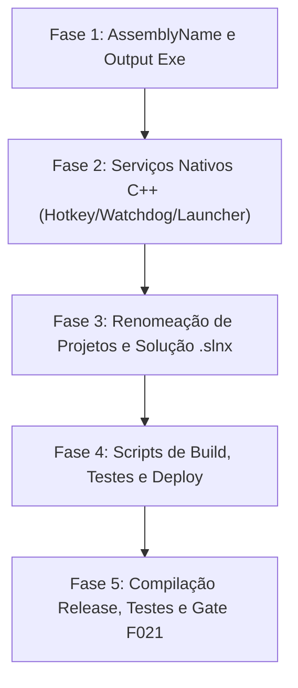

# F084 — Plano de Implementação: Refatoração de Módulos e Executáveis para KyraFiles

## 1. Arquitetura da Transição

Para garantir que a compilação e a estabilidade do sistema não quebrem durante a refatoração, as alterações serão estruturadas em fases progressivas:

---

## 2. Estratégia de Execução

### Fase 1: `AssemblyName` e Saída do Executável Principal
- Em `src/KyraFiles.App/KyraFiles.App.csproj`:
  - Definir `<AssemblyName>KyraFiles</AssemblyName>`.
  - Definir `<TargetName>KyraFiles</TargetName>`.
  - Atualizar `AppxManifest.xml` para apontar `Executable="KyraFiles.exe"`.
  - Atualizar chamadas de processo e detecção de instâncias.

### Fase 2: Serviços Nativos C++
- Atualizar `src/KyraFiles.HotkeyService/main.cpp`:
  - `SHUTDOWN_EVENT_NAME`: `Global\KyraFiles_ShutdownHotkeyService`
  - `INSTANCE_MUTEX_NAME`: `Global\KyraFiles_HotkeyService_InstanceMutex`
  - Chamada de ativação: `ShellExecuteW(NULL, L"open", L"kyrafiles:", NULL, NULL, SW_SHOWNORMAL)`
- Atualizar `src/KyraFiles.Watchdog/main.cpp`:
  - `HOTKEY_EXE_NAME`: `KyraFiles.HotkeyService.exe`
  - Mutexes e eventos de desligamento.
- Atualizar projetos `.vcxproj`:
  - `TargetName`: `KyraFiles.HotkeyService` e `KyraFiles.Watchdog`.

### Fase 3: Renomeação de Projetos e Solução
- Atualizar `Files.slnx` para `KyraFiles.slnx`.
- Renomear os arquivos `.csproj` mantendo os caminhos e referências consistentes:
  - `KyraFiles.App.csproj` $\rightarrow$ `KyraFiles.App.csproj` (ou manter pastas e alterar AssemblyName/RootNamespace).
  - `KyraFiles.Shared.csproj` $\rightarrow$ `KyraFiles.Shared.csproj`
  - `KyraFiles.Core.Storage.csproj` $\rightarrow$ `KyraFiles.Core.Storage.csproj`
  - `KyraFiles.App.Storage.csproj` $\rightarrow$ `KyraFiles.App.Storage.csproj`
  - `KyraFiles.App.Controls.csproj` $\rightarrow$ `KyraFiles.App.Controls.csproj`
  - `KyraFiles.App.CsWin32.csproj` $\rightarrow$ `KyraFiles.App.CsWin32.csproj`
  - `KyraFiles.App.Search.Index.csproj` $\rightarrow$ `KyraFiles.App.Search.Index.csproj`
  - `KyraFiles.App.Server.csproj` $\rightarrow$ `KyraFiles.App.Server.csproj`
  - `KyraFiles.App.IndexService.csproj` $\rightarrow$ `KyraFiles.App.IndexService.csproj`
  - `KyraFiles.App.BackgroundTasks.csproj` $\rightarrow$ `KyraFiles.App.BackgroundTasks.csproj`
  - `KyraFiles.Core.SourceGenerator.csproj` $\rightarrow$ `KyraFiles.Core.SourceGenerator.csproj`

### Fase 4: Scripts de Build, Testes e Atualização
- Atualizar `tools/Deploy-Release.ps1` para gerenciar os processos `KyraFiles`, `KyraFiles.Watchdog`, `KyraFiles.HotkeyService` e instalar em `%LOCALAPPDATA%\Programs\KyraFiles`.
- Atualizar `tools/Build-Native.ps1`.
- Atualizar `tools/perf/verify_no_index_service.ps1` e `tools/perf/verify_win_e_health.ps1`.

### Fase 5: Compilação e Validação de Qualidade
- `mkfile r` com 0 erros.
- `dotnet test` com 100% de sucesso.
- Execução do Gate F021 e do verificador Win+E.

